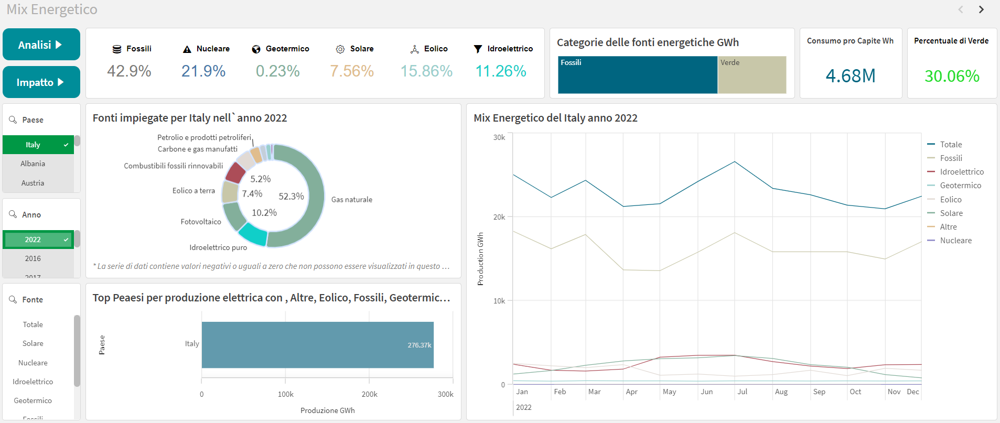
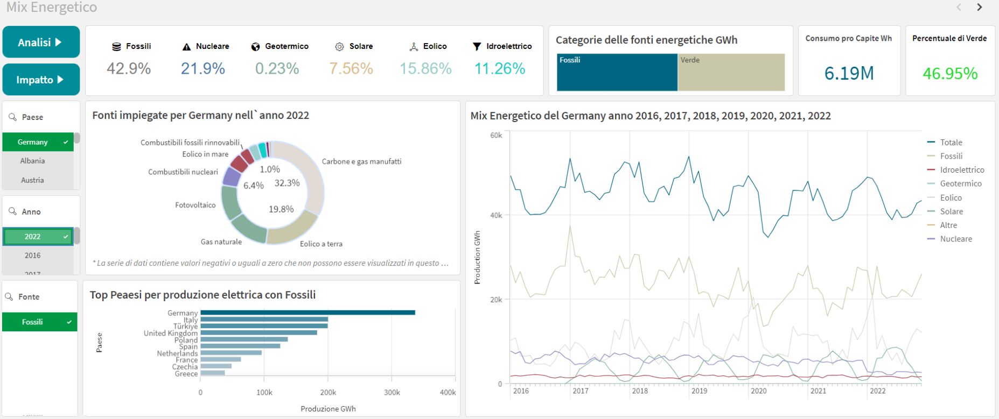
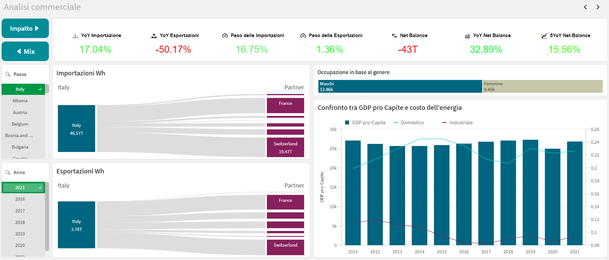
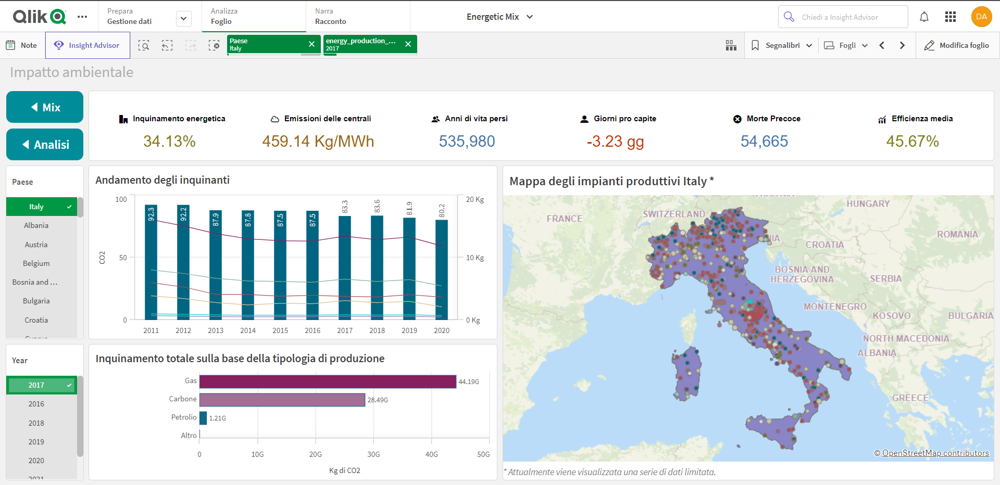
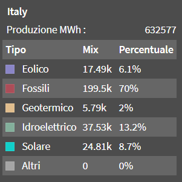

Developed in collaboration with Damiano and Daniele, this project explores the European electricity sector across three dimensions: **internal power generation mix**, **cross-border electricity trade & socio-economic impact**, and **environmental emissions & plant efficiency**.

## Objectives & Data Sources

- **Objectives:**
  - Visualize the electricity production mix across European countries (2016–2022).
  - Analyze intra-European cross-border energy imports, exports, and grid dependency.
  - Quantify the environmental and public-health impact of the power sector.
- **Data Sources (Eurostat & Joint Research Centre - JRC):**
  - Domestic electricity generation by source (Fossil, Nuclear, Geothermal, Solar, Wind, Hydro).
  - Cross-border physical imports and exports.
  - Socio-economic indicators (household/industrial electricity prices, GDP per capita, gender employment ratios).
  - Geolocation, generation efficiency, and $\text{CO}_2$ / $\text{PM}_{10}$ / $\text{PM}_{2.5}$ emissions of European power plants.

---

## 1. Energy Generation Mix Dashboard

### Italy Energy Mix (2022)

The **Energy Mix** dashboard tracks each European country's domestic production across the six primary sources: **Fossil, Nuclear, Geothermal, Solar, Wind, and Hydroelectric**.
- **Top KPIs:** Compare national shares against European averages, track the ratio of Green + Nuclear vs. Fossil generation, and measure annual per-capita electricity consumption alongside the green energy consumption share.
- **Seasonality & Composition:** For Italy in 2022, natural gas remained the dominant fossil source, while the 2016–2022 monthly time series highlights clear seasonal patterns—summer peaks for solar and hydroelectric generation, spring/autumn peaks for wind, and steady baseload output from geothermal plants.

### Germany Energy Mix (2022)

In Germany, per-capita electricity consumption reached **6.19 MWh** (-11.5% vs. 2016). In 2022, **46.95%** of German consumption came from green sources (+14.72% over 7 years), driven by wind and solar expansion as nuclear capacity was phased out.

---

## 2. Commercial Trade & Socio-Economic Analysis

### Italy Trade Balance (2021)

The **Commercial Analysis** dashboard evaluates external energy dependency and household price burdens:
- In 2021, Italy was a net electricity importer of **43 TWh** (primarily from Switzerland and France), with foreign dependency increasing by 15.56% since 2016.
- Between 2011 and 2015, household electricity costs in Italy rose by 25% while GDP per capita declined by 4.3%, making energy affordability an increasingly critical macroeconomic factor.

### France Trade Balance (2021)

By contrast, France maintained a positive net trade surplus of **45 TWh** in 2021 (+8.17% over 5 years), confirming its position as Europe's largest electricity exporter to Italy, the UK, Belgium, and Spain.

---

## 3. Environmental Impact & Power Plant Geolocation

The third dashboard evaluates national grid efficiency, the decarbonization index (indexed to $100$ in the year 2000), and $\text{kg CO}_2\text{/MWh}$ intensity by plant type, alongside geospatial mapping of individual European power plants:

