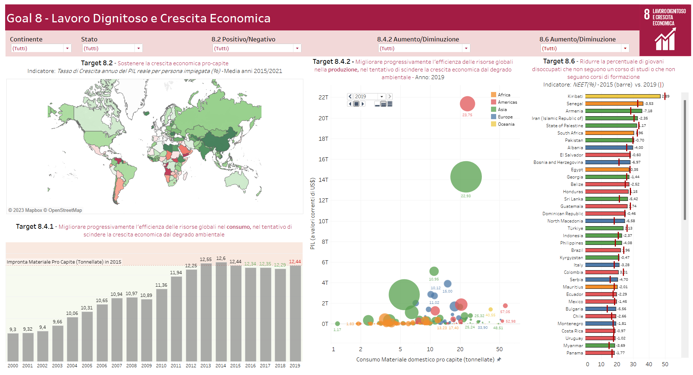
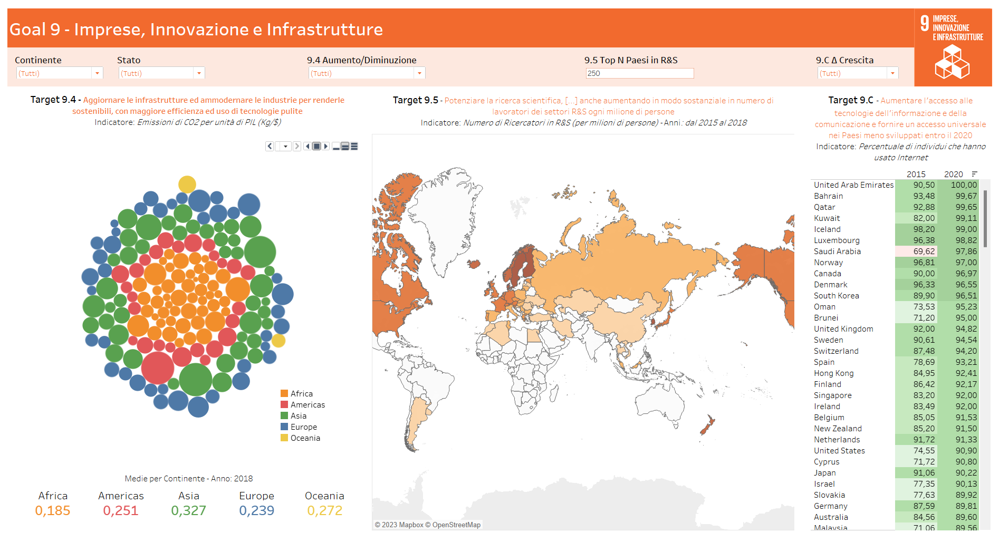
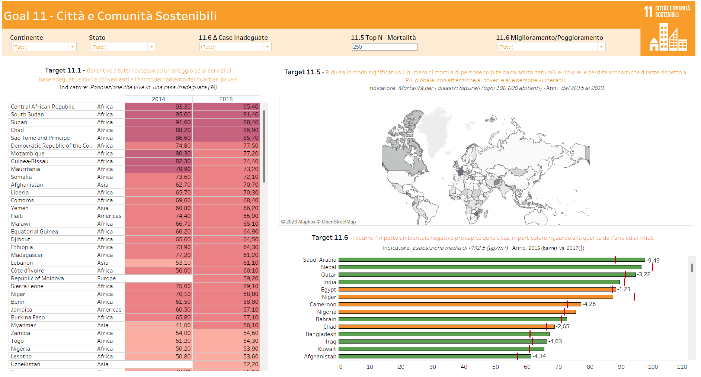

Created in collaboration with Damiano and Daniele, this project evaluates global mid-term progress toward the **United Nations 2030 Agenda for Sustainable Development**, adopted in 2015. Using harmonized indicators from **Our World in Data** (UN, World Bank, OECD, IMF, ILO), we designed three interactive **Tableau** dashboards focused on **Goal 8**, **Goal 9**, and **Goal 11**.

---

## Goal 8 — Decent Work and Economic Growth

- **GDP Growth per Employed Person (2016–2021):** Highlights strong positive productivity growth across Asian economies, contrasted with stagnant pre- and post-pandemic growth in Italy (-0.2% average).
- **Material Footprint per Capita:** Global resource consumption averaged **12.44 tonnes per person** in 2019, showing that economic expansion in emerging economies remains tightly coupled with domestic material consumption.
- **Youth NEET Rate (2015 vs. 2019):** Tracks the share of young people Not in Education, Employment, or Training, where Italy ranked fourth highest in Europe (improving from 21% in 2015 to 18% in 2019).

---

## Goal 9 — Industry, Innovation and Infrastructure

- **Carbon Intensity of GDP ($\text{kg CO}_2$ per USD):** Compares emissions efficiency across continents (0.327 kg/\$ in Asia vs. 0.239 kg/\$ in Europe and 0.251 kg/\$ in the US in 2018), with Italy outperforming the European average at **0.168 kg/\$**.
- **R&D Researchers per Million Inhabitants:** Highlights the gap between Nordic/East Asian innovation leaders (Denmark at ~8,000 researchers per million) and Italy (36th globally at ~2,300 researchers per million).
- **Universal Internet Access (2015 vs. 2020):** Tracks digital infrastructure adoption across developing regions.

---

## Goal 11 — Sustainable Cities and Communities

- **Urban Living Standards & Housing Deprivation (2014–2018):** Measures the share of populations living in overcrowded housing or lacking clean water and sanitation.
- **Human & Economic Cost of Natural Disasters:** Contrasts heatwave mortality in Europe with extreme hurricane-related economic damages in the United States (~90B USD/year average from 2016 to 2021).
- **$\text{PM}_{2.5}$ Air Pollution Exposure:** Compares population exposure across income tiers and energy regimes.
