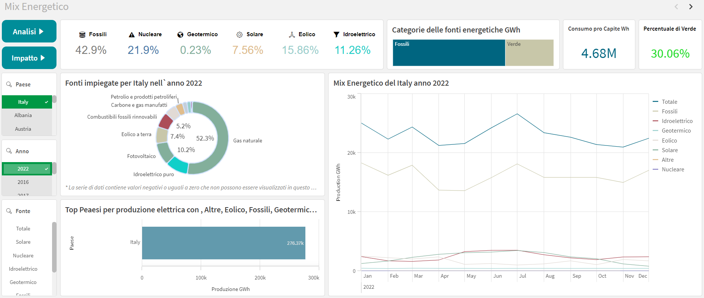
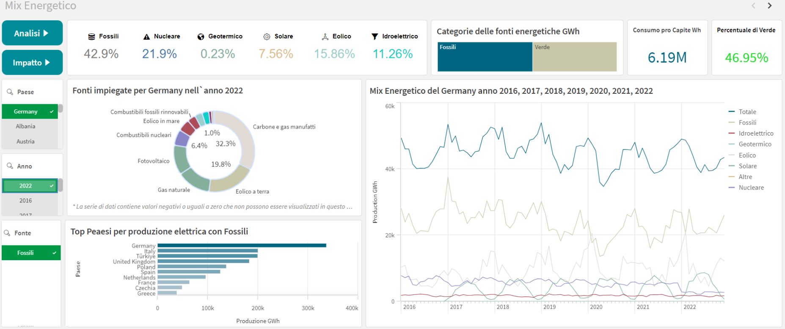
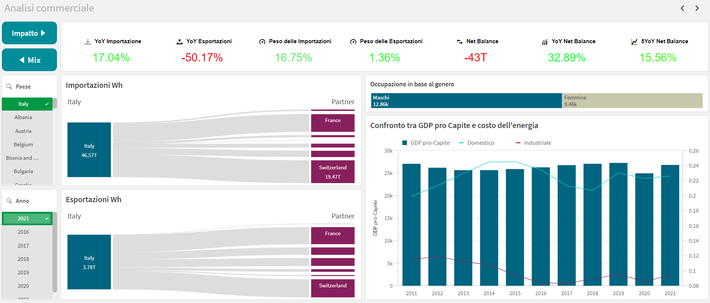
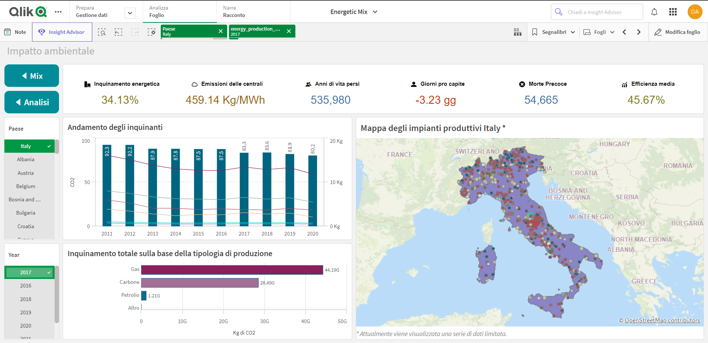
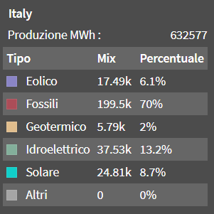

Questo progetto, realizzato in collaborazione con Damiano e Daniele, analizza il settore elettrico europeo lungo tre direttrici: **mix di produzione interna**, **scambi commerciali transfrontalieri e indicatori socio-economici**, e **impatto ambientale ed efficienza degli impianti**.

## Obiettivi e Dati (Eurostat e JRC)

- **Obiettivi:**
  - Visualizzare il mix di produzione elettrica dei Paesi Europei (2016–2022).
  - Analizzare gli scambi comunitari di importazione ed esportazione.
  - Valutare l'impatto ambientale e sanitario del settore energetico.
- **Dati Eurostat e Joint Research Centre (JRC):**
  - Produzione interna sulla base delle fonti impiegate (Fossile, Nucleare, Geotermico, Solare, Eolico, Idroelettrico).
  - Flussi fisici di import ed export.
  - Indicatori socio-economici, emissioni del settore energy, geolocalizzazione e performance delle centrali elettriche europee.

---

## 1. Dashboard Mix Energetico

### Mix Energetico Italia (2022)

La dashboard **Mix Energetico** consente di analizzare in dettaglio la produzione interna di energia di ciascun paese europeo:
- **KPI principali:** Confrontano il valore medio europeo delle sei principali fonti di energia (*Fossile, Nucleare, Geotermico, Solare, Eolico e Idroelettrico*), la quota di energia prodotta da fonti verdi/nucleari rispetto alle fossili e il consumo annuo pro capite.
- **Fonti impiegate e stagionalità:** Il grafico a ciambella mostra la composizione del mix italiano nel 2022 (con prevalenza del gas naturale tra le fonti fossili), mentre la serie storica mensile 2016–2022 evidenzia la stagionalità di solare e idroelettrico (picco estivo), eolico (primavera/autunno) e la costanza del geotermico.

### Mix Energetico Germania (2022)

In Germania il consumo pro capite nel 2022 è stato di **6,19 MWh** (-11,5% rispetto al 2016), con il **46,95%** dei consumi coperto da fonti verdi (+14,72% negli ultimi 7 anni) grazie alla forte crescita di eolico e solare in parallelo alla dismissione nucleare.

---

## 2. Analisi Commerciale e Socio-Economica

### Italia (2021)

La seconda dashboard approfondisce la bilancia commerciale dell'energia elettrica:
- Nel 2021 l'Italia è risultata importatore netto per **43 TWh** (principalmente da Svizzera e Francia), con un incremento della dipendenza energetica dall'estero del 15,56% rispetto al 2016.
- Viene inoltre analizzato l'impatto dell'aumento dei costi dell'elettricità domestica rispetto alla dinamica del PIL pro capite.

### Francia (2021)

Nel 2021 la Francia ha mantenuto una bilancia commerciale positiva di **45 TWh** (+8,17% rispetto ai 5 anni precedenti), confermandosi il principale esportatore europeo verso Italia, Regno Unito, Belgio e Spagna.

---

## 3. Impatto Ambientale e Mappa delle Centrali

La terza dashboard mette in evidenza l'efficienza delle reti produttive nazionali, l'andamento dell'indice di decarbonizzazione (base $100$ nel 2000), le emissioni di $\text{kg CO}_2\text{/MWh}$ per tipologia di impianto e la mappa interattiva delle centrali elettriche sul territorio europeo:

