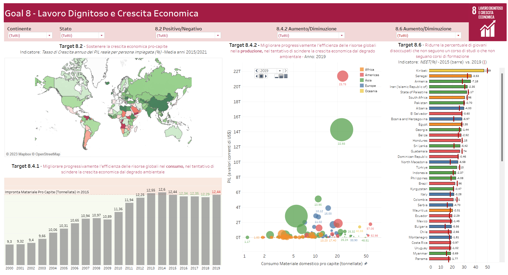
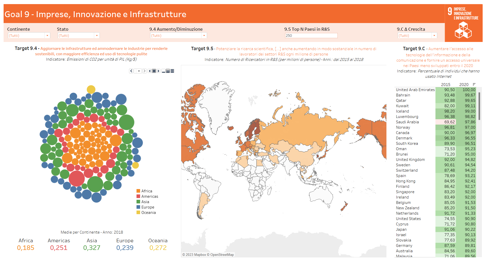
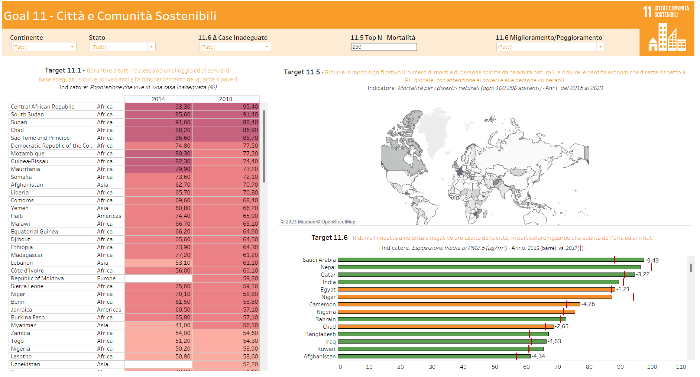

Realizzato in collaborazione con Damiano e Daniele, questo progetto analizza lo stato di avanzamento dell'**Agenda ONU 2030 per lo Sviluppo Sostenibile** a metà del percorso iniziato nel 2015. Utilizzando le statistiche ufficiali raccolte da **Our World in Data** (ONU, World Bank, OECD, IMF, ILO), abbiamo sviluppato tre dashboard interattive in **Tableau** dedicate ai **Goal 8, Goal 9 e Goal 11**.

---

## Goal 8 — Lavoro Dignitoso e Crescita Economica

- **Tasso di crescita del PIL per occupato (2016–2021):** Evidenzia la crescita sostenuta dei paesi asiatici rispetto alla stagnazione italiana (-0,2% medio annuo dal 2016).
- **Impronta materiale pro capite:** Nel 2019 il consumo medio globale ha raggiunto **12,44 tonnellate di risorse per persona**, mostrando quanto sia ancora complesso disaccoppiare la crescita del PIL dal consumo interno di risorse materiali.
- **Tasso di NEET (2015 vs. 2019):** Confronta la percentuale di giovani non occupati né inseriti in un percorso di istruzione, con l'Italia al quarto posto in Europa (dal 21% nel 2015 al 18% nel 2019).

---

## Goal 9 — Imprese, Innovazione e Infrastrutture

- **Intensità carbonica del PIL ($\text{kg CO}_2$ per dollaro di PIL):** Confronta le emissioni per unità di PIL tra continenti (0,327 kg/\$ in Asia contro 0,239 kg/\$ in Europa e 0,251 kg/\$ negli USA nel 2018), con l'Italia tra i paesi più virtuosi (**0,168 kg/\$**).
- **Investimenti in R&S (Ricercatori per milione di abitanti):** Evidenzia l'alta propensione alla ricerca dei paesi nordici (Danimarca in vetta con ~8.000 ricercatori per milione di abitanti) rispetto alla 36ª posizione dell'Italia (~2.300 ricercatori per milione).
- **Accesso a Internet (2015 vs. 2020):** Mappa il divario infrastrutturale digitale a livello globale.

---

## Goal 11 — Città e Comunità Sostenibili

- **Disagio abitativo e accesso ai servizi essenziali (2014–2018):** Analizza la quota di popolazione in abitazioni sovraffollate o prive di acqua potabile e servizi igienici.
- **Impatto umano ed economico dei disastri naturali:** Confronta la mortalità legata alle ondate di calore in Europa con i danni economici causati dagli uragani negli Stati Uniti (~90 miliardi di dollari/anno tra il 2016 e il 2021).
- **Esposizione media a $\text{PM}_{2.5}$:** Analizza la correlazione tra inquinamento atmosferico urbano, reddito pro capite e fonti energetiche impiegate.
